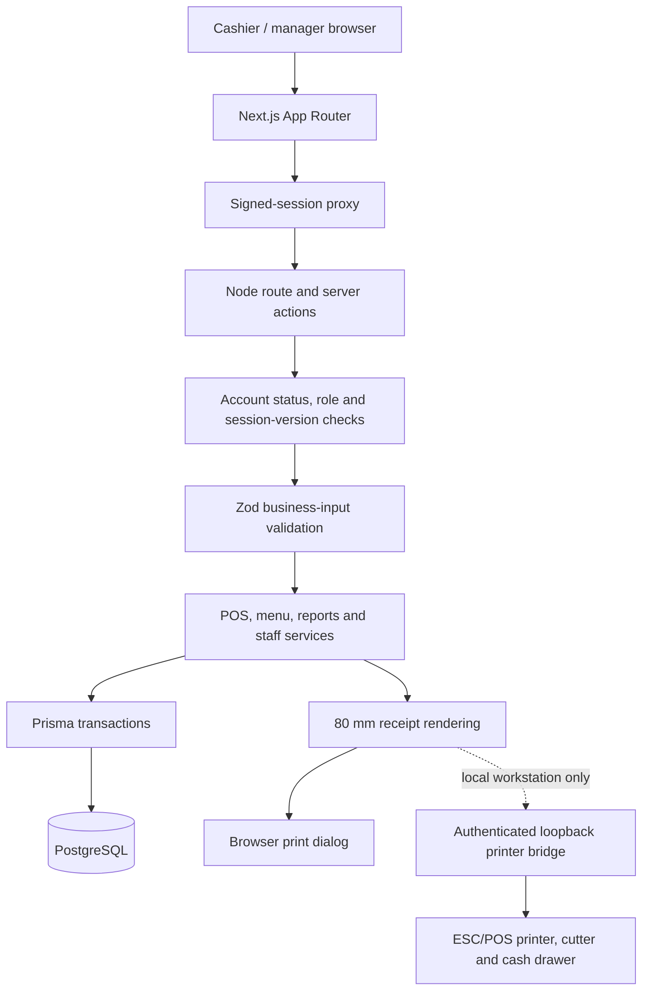

# Architecture

Startek Restaurant POS is a single Next.js application with a PostgreSQL datastore. It serves browser clients in two deployment environments: a local workstation configuration used for printer integration and an isolated cloud evaluation environment. Both environments share business logic but enforce different filesystem and hardware policies.

## Request and data flow

The Edge proxy performs an early signed-session check. It **does not** replace the authorization checks near database operations. Node-side handlers confirm the current account state and role, including session revocation after account deactivation or password changes.

## Checkout guarantees

1. The browser submits items and a tender selection; price, availability and settings are reloaded on the server.
2. Server validation rejects unsupported adjustments and tampered prices.
3. Order, line items, payment record and audit record are persisted together using a Prisma database transaction.
4. Unique invoice and checkout-token constraints protect against duplicate submissions and retries. Concurrent replay behavior is covered by browser tests.
5. Receipt and export records use saved order details, including item-name snapshots for newly created orders.

**Important:** Selecting card or QR records the tender method. No external payment gateway transaction, card authorization or QR transfer verification is performed by this application.

## Persistence and recovery

PostgreSQL stores users, roles, menu, order snapshots, payments, expenses, settings and audit information. Prisma migrations are versioned in `prisma/migrations`. Migrations must be reviewed and deployed explicitly; never use destructive resets on customer data.

The local installation can create private PostgreSQL custom-format backups for manual recovery. Cloud evaluation uses an operator-managed database recovery process; local filesystem backups and in-process restore actions are intentionally unavailable there. Recovery evidence is documented in [Release verification](PORTFOLIO_RELEASE.md).

## Environment boundaries

| Capability | Workstation deployment | Netlify evaluation |
| --- | --- | --- |
| Browser-based POS and reports | Supported | Supported |
| Database | Configured local/managed PostgreSQL | Separate Neon staging branch |
| Browser 80 mm receipt | Supported | Supported |
| Direct printer/cutter/drawer commands | Optional approved local bridge | Disabled |
| Local uploaded logos | Requires persistent local storage | Disabled pending durable cloud storage |
| Local PostgreSQL backup | Private `BACKUP_DIR` | Disabled; managed recovery required |
| Runtime | Node process | Netlify Node handler plus Edge proxy |

The isolated Netlify site contains synthetic records and should not be connected to live POS credentials or transaction data without a separately approved migration, backup plan and hardware test.

## Project organization

- `src/app` — application routes, pages and API boundaries
- `src/components` — UI components and receipt presentation
- `src/features` — business modules, server services, actions and validation
- `src/lib` — shared infrastructure, Prisma and authorization helpers
- `prisma` — schema, migrations and development seed
- `tests` — unit and isolated browser/integration checks
- `scripts` — cloud build, local POS lifecycle and printer tooling
- `docs` — operations, release evidence and synthetic demo media

## Security and unresolved acceptance

Access control is enforced server-side; client UI restrictions are not sufficient. Never commit local dotenv files or authentication tokens, and do not publish seeded admin credentials. The cloud build rejects local dotenv files; deployment artifacts should be inspected for secrets.

The recorded security incident has unresolved external questions about historical artifact access and Windows secret reuse. The physical printer, cutter, drawer and live failover also require an authorized on-site acceptance test. These items are **not** software test passes. See [Security](../SECURITY.md) and [Release verification](PORTFOLIO_RELEASE.md).
